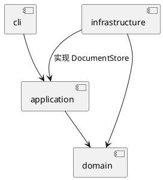

# SVG 命令行编辑器

## 1. 仓库地址

高级软件开发 Lab1 Phase 1，TypeScript 实现，支持 `rect / circle / ellipse / line / text / g`、组合编辑和撤销重做。

- GitHub：[Resona-02/svgsoftwarelab1](https://github.com/Resona-02/svgsoftwarelab1)
- **最新实现请看 main**；`final` 是最初验收版本，早于本次 Command 重构。
- 本文件与 `doc/README.md` 内容一致。

## 2. 运行方法

需要 Node.js 22 或更新版本：

```sh
git clone git@github.com:Resona-02/svgsoftwarelab1.git
cd svgsoftwarelab1
npm ci
npm run cli
```

出现 `svg>` 后输入，`help` 查看用法，`Ctrl+D` 退出：

```text
init 800 600
create rect r1 10 20 100 50 red
move r1 30 0
undo
redo
save demo.svg
```

保存的 SVG 可用浏览器打开。脚本回放：`npm run cli < examples/flowchart.commands`。

## 3. Command 如何体现在各模块中

**入口请求执行，命令只转发，接收者完成业务。** 按课程 Command 讲义第 12、16–21、24 页的分工设计：

| 模块 / 类 | 职责与设计理由 |
| --- | --- |
| `cli/CommandFactory`（Client） | 解析文字、创建命令并绑定接收者。集中管理命令名称，不执行业务 |
| `cli/CommandDispatcher`（CLI 入口） | 只取得抽象 `Command` 并交给执行器，处理输出错误；不依赖文档或接收者 |
| `application/Command`、具体 `*Command` | 保存请求参数和接收者；`execute()` / `undo()` 只有转发调用，不查图形、不计算、不编排业务 |
| `application/CommandExecutor`（Invoker） | 统一执行所有命令；调用 execute/undo/redo，成功后通知 `History` 迁移命令；文件与显示命令也从这里调度 |
| `application/History` | 只保存命令对象、维护两个栈及历史屏障；不调用命令，也不操作业务对象 |
| `application/EditReceiver`（Receiver） | 查找对象、组织编辑、记录局部旧状态、处理失败回滚与反馈；`UndoState` 保存每条编辑的恢复操作 |
| `application/EditorSession`、`ViewReceiver`、`HelpReceiver` | 分别处理文档生命周期、图形展示和帮助说明；帮助接收者不引用 Client，历史请求由会话转交执行器 |
| `domain` | `SvgDocument` 管唯一 id 与树规则；各 `Shape` 子类维护私有几何字段；`Group` 通过 Composite 递归操作孩子；`ShapePlacements` 记录受影响节点的旧位置 |
| `infrastructure` | `SvgFileStore` 实现 `DocumentStore` 接口，`SvgCodec` 处理 XML；接收者不用了解磁盘与 XML 细节 |
| `main.ts` | 集中组装会话、接收者、命令工厂、执行器和 CLI |

移动命令的执行方法只有这一句：

```ts
return this.receiver.move(this.state, this.id, this.dx, this.dy);
```

`state` 是每条命令持有的局部撤销记录，由接收者填写和恢复；命令本身不解释或修改这些状态。

**五个角色：** Command 是统一接口，ConcreteCommand 是具体 `*Command`，Client 是 `main.ts` 与 CommandFactory，Invoker 是 CommandExecutor，Receiver 是各业务接收者；领域对象封装具体规则。

**协作时序：** 创建阶段由 Client 组装接收者与命令，不修改文档；执行阶段为 `入口 → CommandExecutor → Command.execute() → Receiver → 领域对象`，此时不再调用 Client。

依赖规则：CLI 依赖应用层；应用层依赖领域层和自己声明的存储接口；基础设施实现接口并依赖领域模型；领域层独立，避免界面或文件实现影响业务规则。



课件的“三种入口”指主菜单、右键菜单、工具栏。本阶段交付 CLI；`CommandTrigger` 只持有 `Command` 和执行器，测试用三个触发器模拟这三种入口，共用一个 SaveCommand。未实现 GUI 界面。

**撤销只记录本次操作需要的旧状态，不保存整份文档或执行后快照：**

| 编辑 | 保存什么以便 undo |
| --- | --- |
| move / scale | 目标的旧几何字段；操作 Group 时记录其受影响后代的几何字段。直接恢复旧值，避免反向计算误差 |
| set | 该对象该属性的旧值，包括“原本未设置” |
| create / delete | 新建或被删对象的引用；删除还记录旧父节点、旧下标。删除子树时保留原对象，不复制 |
| group / ungroup | 受影响节点的旧父节点、旧下标；解组另记录直接子节点可能改变的继承样式 |
| addto / front / back | 被移动节点的旧父节点、旧下标 |

**栈时序：** 新编辑执行成功后 push 到 undo 并清空 redo；undo 取最近命令调用 undo，成功后从 undo 转入 redo；redo 取最近命令再次 execute，成功后从 redo 转回 undo。课件第 22–24 页画的是先 push/pop 再调用；这里先 peek、操作成功再迁移，保持成功后的栈状态一致并避免失败命令污染历史。

失败时逆序执行本条编辑的局部恢复操作；成功后才入历史。undo 后的新编辑清空 redo。成功 init/read/save 或调整画布尺寸按作业要求清空并锁定历史，下一次成功编辑解锁；查询不入栈。保存文件时的临时文档副本用于隔离写入，不进入撤销历史。

历史内存随**实际受影响的数据量**增长；删除大子树仍需保留该子树，整体移动大组仍需记住各节点的旧几何值。新增编辑时添加接收者方法、薄命令类和工厂注册即可；新增图形通过 Shape 子类和 ShapeFactory 扩展。

## 4. 测试如何推动改进

```sh
npm run check
npm test
```

2026-10-20 验证：类型检查通过，**77 项测试通过，0 项失败**；模块依赖检查与命令转发约束通过。

| 测试场景 | 促成的改进或验证 |
| --- | --- |
| 原版本整份文档快照、命令内组织业务 | 改为接收者处理业务与局部撤销；架构测试约束所有命令执行方法只做转发 |
| 禁止文档和图形 clone 后执行全部编辑与撤销重做；检查对象引用 | 确认历史不依赖文档复制，也不会替换未编辑对象 |
| 文档增加 1,000 个无关图形，单目标移动 100 次 | 验证每次只采集目标旧几何状态；不随无关图形数量扩张撤销记录 |
| 三个模拟入口、CLI 全部命令、重复 redo | 验证统一执行器、接收者绑定，以及 redo 真正重新执行 |
| 创建后禁用 Client、跟踪调用顺序与栈迁移、模拟 undo 失败 | 帮助命令改绑独立接收者；execute/undo/redo 集中到执行器，History 只管存储；验证后进先出及失败不丢历史 |
| 跨父节点分组、解组继承样式、浮点值恢复、编辑及重做中途溢出 | 验证原位置与属性精确恢复、失败原子性及两个历史栈保持正确 |
| 根 id 冲突、非法数值、中文与 XML、文件写入失败 | 保留原有修复与回归测试，确保重构不破坏既有功能 |

用户提出课件与内存约束后，AI 对照讲义重构；再次严格审查发现帮助命令仍依赖 Client、History 混合执行职责，现已分离并补充时序测试，Git 保留修改记录。当前不是完整 SVG/CSS 引擎，不实现本阶段之外的 box 和插件加载器。GitHub Actions 使用同样的类型检查和测试，远程结果以 Actions 页面为准。
