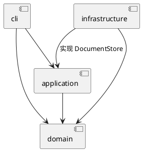

# SVG 命令行编辑器

## 1. 仓库地址

高级软件开发 Lab1 Phase 1，使用 TypeScript 实现，支持六类 SVG 图形、组合编辑和撤销重做。

- GitHub：[https://github.com/Resona-02/codex](https://github.com/Resona-02/codex)
- 首次验收版本：[final](https://github.com/Resona-02/codex/tree/final)
- 最新说明以 main 分支为准；本文件与 `doc/README.md` 内容一致。

## 2. 运行方法

需要 Node.js 22 或更新版本。

```sh
git clone git@github.com:Resona-02/codex.git
cd codex
npm ci
npm run cli
```

出现 `svg>` 后输入命令，`help` 查看用法，`Ctrl+D` 退出：

```text
init 800 600
create rect r1 10 20 100 50 red
move r1 30 0
undo
redo
save demo.svg
```

`save` 生成的 SVG 可用浏览器打开；也可运行完整示例：

```sh
npm run cli < examples/flowchart.commands
```

## 3. Command 模式与模块设计

**每条编辑操作封装成独立命令对象，由统一入口执行并管理历史，图形对象负责实际业务行为。** 例如 `MoveCommand` 保存目标 id 和移动量，执行时查找图形并调用 `shape.move()`。

| 模块 | 如何参与 Command 设计 | 为什么这样划分 |
| --- | --- | --- |
| `cli` | `CommandDispatcher` 解析输入，创建 `MoveCommand` 等对象，再交给会话执行；承担 Client 角色 | 输入解析与编辑行为分开，后续其他入口可复用命令 |
| `application` | `EditCommand` 定义统一命令抽象；10 个具体命令实现 `apply()`；`History` 是 Invoker，管理撤销和重做；`EditorSession` 持有当前文档 | 共用执行、回滚和历史规则，减少重复代码 |
| `domain` | `SvgDocument` 和各图形类承担 Receiver 角色，处理树结构、几何与属性规则 | 字段封装、行为由对象维护；命令无需知道每种图形的计算细节 |
| `infrastructure` | `SvgFileStore` 实现应用层的 `DocumentStore` 接口，`SvgCodec` 转换 SVG 和图形对象 | 隔离文件与 XML 操作，便于替换存储实现和模拟读写失败 |
| `main.ts` | 创建上述对象，将文件实现注入会话，启动 CLI | 对象连接集中在入口，各模块职责明确 |

以移动命令为例，运行顺序是：

```text
输入 → CommandDispatcher 创建 MoveCommand
     → EditorSession → History.execute
     → EditCommand.execute → MoveCommand.apply
     → SvgDocument.find → Shape.move
```

**撤销和回滚：** `EditCommand.execute()` 深复制执行前、后的文档。undo 恢复前快照，redo 恢复后快照；中途失败也恢复前快照。`History` 只记录成功命令，撤销后出现新编辑会清空 redo。一次分组即使修改多个节点，也只占一个撤销单元。成功 init/read/save 或修改画布尺寸会按作业要求建立历史屏障，下一条成功编辑解除；显示和查询不入栈。

**面向对象与 Composite：** Rect、Circle 等类维护私有几何字段并实现自己的 move/scale；Group 同样继承 Shape，将操作递归交给子节点。因此同一个 MoveCommand 可以移动矩形或整组图形，无需按图形类型分别处理。

**依赖方向：** 领域层不依赖终端和文件系统；应用层只通过接口访问文件。图中箭头表示源码依赖：



采用“一类一文件”和少量接口以便维护。新增编辑操作时添加命令类并注册；新增图形时添加 Shape 子类并在 ShapeFactory 注册。命令名和图形类型名只在这两个位置集中分派，留待后续插件阶段重构；本阶段不实现 box 或插件加载器。

快照方案优先保证结构恢复容易理解和验证，代价是内存随历史数量与文档大小增长，适合本阶段小型文档。

## 4. 测试如何推动代码改进

```sh
npm run check
npm test
```

2026-10-20 复验：严格类型检查通过，**61 项测试通过、0 项失败**。测试覆盖六类图形、全部编辑命令的撤销重做、SVG 往返读写、CLI 脚本回放和模块依赖规则。优化重点是数据一致性和可维护性：

| 测试与审查场景 | 推动的改进或验证 |
| --- | --- |
| 导入 SVG 根元素已有 id，再创建同名图形；输入十六进制等非法几何数值 | 将根 id 纳入全局查重，统一为有限十进制、浮点及指数校验，并加入回归测试 |
| 解组带继承样式的容器 | 将基本样式落实到子节点；复杂样式无法安全保持时明确拒绝，避免外观静默改变 |
| 容器前一子节点操作成功、后一子节点溢出；连续撤销后再编辑 | 验证整份文档回滚、快照独立及历史不被破坏，统一使用基类恢复机制 |
| 错误命令、缺 id、文件失败、中文与 XML 特殊字符 | 验证失败保持原状态，自动补 id 避开冲突，保存后可正确读回 |
| 一类一文件、源码导入方向、真实入口脚本 | 自动约束既定架构，并确认各类单独正确之外，完整程序也能运行 |

开发由用户确认需求与可维护性目标，AI 分阶段实现并交叉审查；上述 id、数值与解组问题均经复现后修正并补测试。Git 历史保留工程、领域模型、Command、SVG IO、修复与验收等阶段，实际目录和依赖与方案一致。

当前支持 `rect / circle / ellipse / line / text / g`，不提供完整 SVG/CSS 引擎。GitHub Actions 已配置相同检查，远程结果以仓库 Actions 页面为准。
