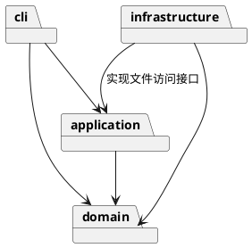
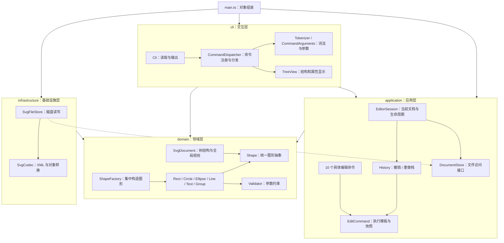
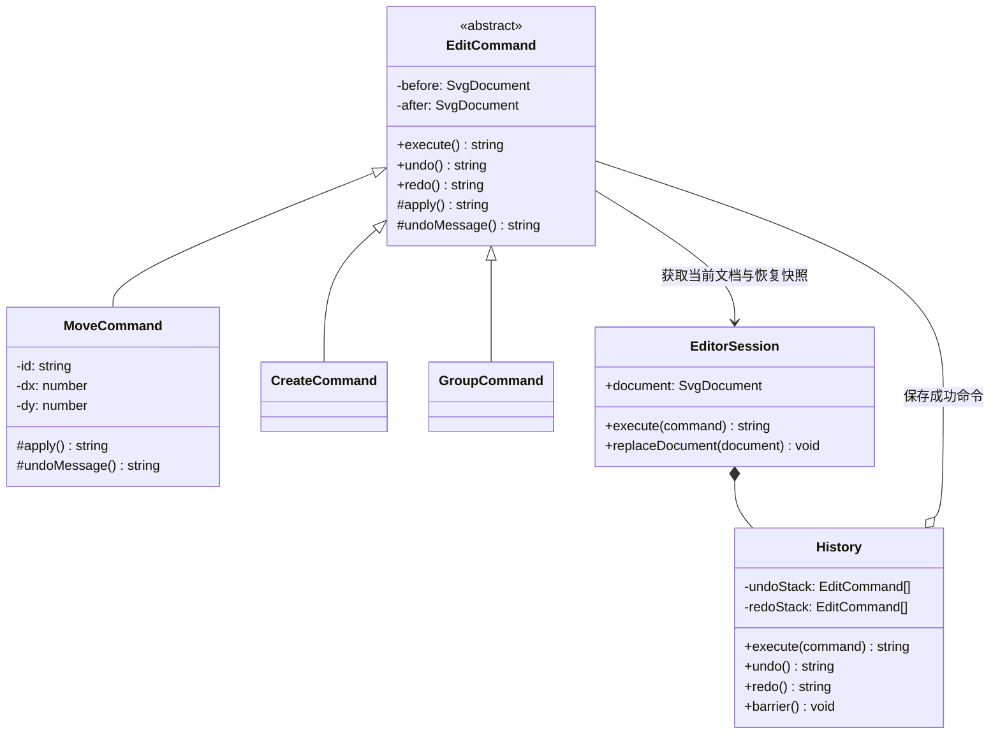
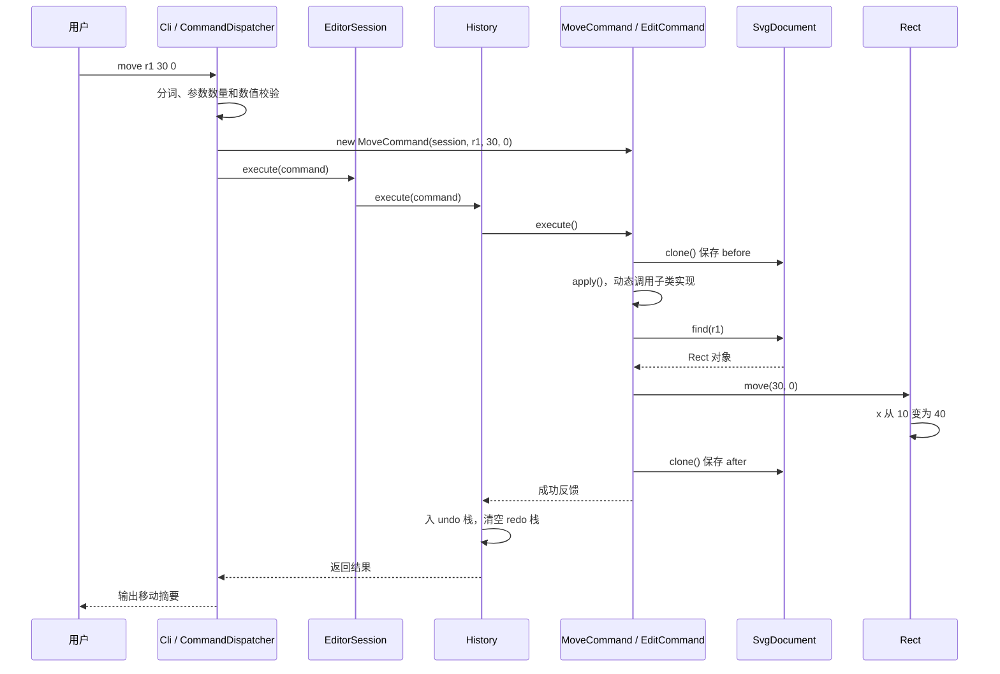
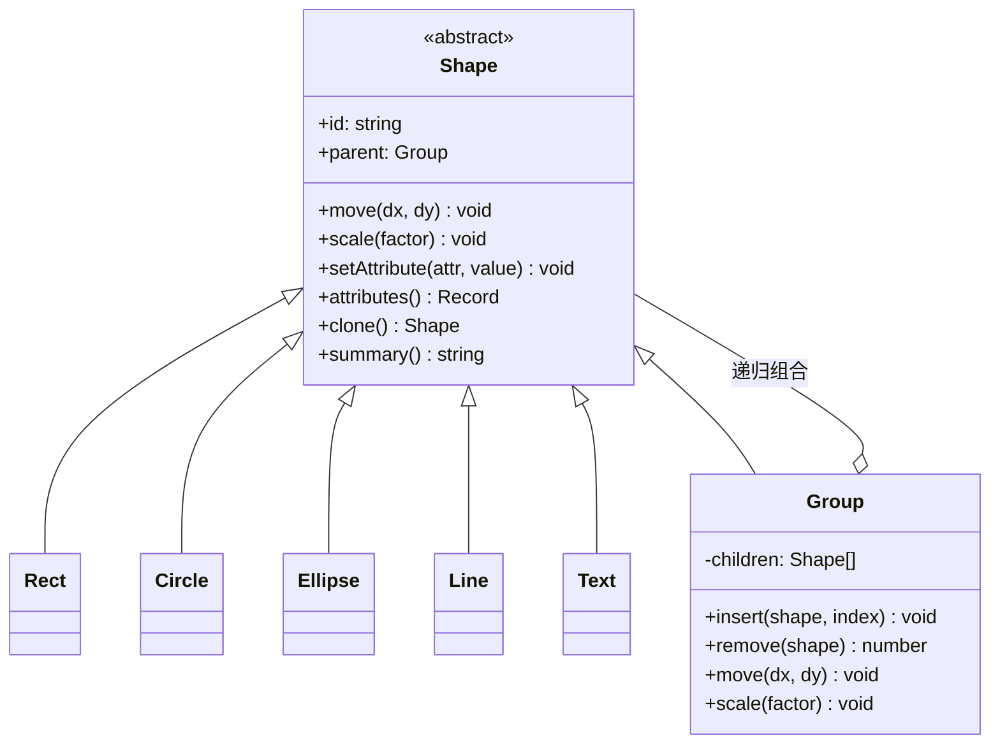

# Lab1 Phase 1：SVG 命令行编辑器——实现、设计与验收报告

## 1. 项目信息与阅读说明

- **Git 仓库地址**：[https://github.com/Resona-02/codex](https://github.com/Resona-02/codex)
- **SSH 克隆地址**：`git@github.com:Resona-02/codex.git`
- **完整报告在线地址**：[README.md](https://github.com/Resona-02/codex/blob/main/README.md)
- **首次功能验收版本**：[final 标签](https://github.com/Resona-02/codex/tree/final)，对应提交 `5c3e586a038c04bc1e34d7d92a3d701d92a720fd`。
- **技术实现**：TypeScript、Node.js，面向对象设计；Command 与 Composite 为核心，配合模板方法、文档快照和集中式图形工厂。
- **报告整理与测试复验日期**：2026-10-20。

本项目完成高级软件开发 Lab1 Phase 1：通过 CLI 创建、编辑、组合、保存和读取 SVG 图形，支持编辑操作撤销与重做。仓库按用户最终决定公开。`package.json` 中的 `private: true` 仅禁止误发布到 npm，不表示 GitHub 仓库私有。

**本文是一份可独立阅读的完整报告**，包含模块图、模式落地、接口、设计理由、行为约定、AI 协作记录、自查和验收说明。根目录 `README.md` 为阅读入口，按课程格式要求在 `doc/README.md` 保留同内容副本，两份内容一致，不拆分章节。

本阶段支持 `rect / circle / ellipse / line / text / g` 六类图形及命令总表。`box`、插件加载和图形界面属于后续阶段，不宣称已经实现。

## 2. 安装、运行与示例

需要 Node.js 22 或更新版本。本次测试使用 Node.js v24.16.0；依赖版本由 `package-lock.json` 锁定。

```sh
git clone git@github.com:Resona-02/codex.git
cd codex
npm ci
npm run cli
```

`npm run cli` 先执行 TypeScript 编译，再启动 `dist/src/main.js`。交互终端显示 `svg>`，输入 `help` 查看语法，`Ctrl+D` 结束；管道输入时不输出交互提示符，便于脚本回放。

```text
init 800 600
create g scene
create rect r1 10 20 100 50 red in scene
create text t1 20 50 "你好 SVG" in scene
move scene 30 0
undo
redo
tree
save demo.svg
```

示例中先在内存建立图形对象树；编辑时修改对象；执行 `save` 才生成 SVG XML 文件。`demo.svg` 可以用浏览器打开。

```sh
npm run cli < examples/flowchart.commands
npm run cli < examples/session.commands
npm run check
npm test
```

`flowchart.commands` 生成两个中文节点与连接线，共 8 个图形节点。`session.commands` 复现典型会话，含两条预期失败操作：祖先和后代同时分组，以及保存后尝试 undo；出现这两条错误是演示结果，不代表脚本实现失败。

主要目录用途：`src` 是维护的源码，`test` 是验证依据，`examples` 存放脚本和 SVG；`dist` 是编译产物，`node_modules` 是依赖，无需同步手工修改。课程 PDF 留在项目目录外，不进入作业代码仓库。

## 3. 完整模块图与依赖方向

实现范围是 Phase 1 的六种内置图形及命令总表。采用适度分层，所有业务实现使用封装字段的类，并保持一类一文件；接口和返回值对象仅用于跨层通信，不承担图形业务行为。

| 模块 | 职责 | 允许依赖 |
| --- | --- | --- |
| `domain` | 图形、组合树、画布、图形工厂及数值校验 | 无上层依赖 |
| `application` | Command、历史、编辑会话与文件访问接口 | domain |
| `infrastructure` | SVG XML 解析和本地文件访问 | application 的接口、domain、XML 库 |
| `cli` | 参数解析、命令分发、REPL 和显示 | application、domain |
| 启动入口 | 创建对象并注入依赖 | 各模块 |



实际工程目录如下，`main.ts` 是创建对象并注入依赖的入口：

```text
src/
  main.ts
  cli/             # Tokenizer、CommandArguments、CommandDispatcher、TreeView、Cli
  application/     # EditorSession、History、EditCommand、10 个具体编辑命令、DocumentStore
  domain/          # Shape、6 类图形、ShapeFactory、SvgDocument、Validator
  infrastructure/  # SvgCodec、SvgFileStore
test/              # 业务、文件、CLI、架构测试和内存文件替身
examples/          # 可回放的命令及生成的 SVG
README.md          # 完整报告
doc/README.md      # 同内容的课程提交副本
```

领域层不导入 Node.js 文件接口、终端接口或第三方库；应用层只依赖领域模型和自身定义的 `DocumentStore`。文件实现通过构造函数注入 `EditorSession`，应用层不直接创建 `SvgFileStore`。CLI 可以读取模型来显示，但编辑统一调用会话和具体命令。

### 3.1 可直接在 GitHub 显示的模块图

实线表示源码依赖，虚线表示接口实现；启动入口负责连接具体对象。



上方 PlantUML 保留课程要求的包图源代码；Mermaid 图补充类级职责，便于直接在 GitHub 阅读。图中的“具体命令 → EditCommand”在源码中是继承关系，下面给出专门的 Command 类图。

## 4. Command 模式如何落实到代码

### 4.1 为什么把一次编辑封装成对象

移动、删除、分组的业务内容不同，但都需要“执行一次、记录成功结果、撤销、重做、失败时不改变状态”。把这些公共规则集中在命令抽象和历史管理器中，可以让具体命令保持短小，避免每增加一项操作就再写一套撤销和错误处理流程。

命令对象保存操作目标和参数，例如 `new MoveCommand(session, "r1", 30, 0)` 表达一次具体请求。接收终端输入的类负责创建它，历史管理器负责调用它，图形对象负责完成实际几何修改。三者通过明确接口协作。

| 模式角色 | 实际类 | 具体职责与原因 |
| --- | --- | --- |
| Client | CommandDispatcher | 从输入选择命令并构造参数；以后其他交互入口也能创建相同命令 |
| Command | EditCommand | 抽象类，统一提供 execute、undo、redo 和快照恢复规则 |
| ConcreteCommand | CreateCommand 等 10 个类 | 各自实现 apply，表达一种业务操作；不重复维护历史栈 |
| Invoker | History | 只依赖 EditCommand，调用成功后入栈，不识别具体命令名字 |
| Receiver | SvgDocument、Shape 的具体子类 | 文档维护树规则，图形维护自身几何与属性 |
| 会话上下文 | EditorSession | 持有当前文档、工厂、默认路径和历史，连接生命周期与编辑 |



图仅展开 3 个具体命令，其余同样继承 EditCommand。完整映射如下：

| 编辑命令 | 具体类 | 业务委托 |
| --- | --- | --- |
| create | CreateCommand | ShapeFactory.create → SvgDocument.add |
| delete | DeleteCommand | SvgDocument.delete |
| move | MoveCommand | Shape.move |
| scale | ScaleCommand | Shape.scale |
| set | SetCommand | Shape.setAttribute |
| group | GroupCommand | SvgDocument.group |
| ungroup | UngroupCommand | SvgDocument.ungroup |
| addto | AddToCommand | SvgDocument.addTo |
| front | FrontCommand | SvgDocument.front |
| back | BackCommand | SvgDocument.back |

### 4.2 用 move 命令串起整个调用过程

先执行 `init` 与 `create rect r1 10 20 100 50 red`，再执行 `move r1 30 0`。运行时顺序如下，需与上一节的静态依赖图区分：



[MoveCommand.ts](https://github.com/Resona-02/codex/blob/main/src/application/MoveCommand.ts) 中实际的业务方法是：

```ts
protected override apply(): string {
  const shape = this.document.find(this.id);
  shape.move(this.dx, this.dy);
  return `${shape.summary()} moved by (${this.dx},${this.dy})`;
}
```

此处通过 Shape 的多态接口调用移动：目标是 Rect 时修改矩形坐标，目标是 Group 时递归移动子节点。MoveCommand 不实现各类图形的几何公式，也不直接修改它们的私有字段。

### 4.3 模板方法、文档快照与失败回滚

[EditCommand.ts](https://github.com/Resona-02/codex/blob/main/src/application/EditCommand.ts) 要求子类实现 `apply()` 和 `undoMessage()`，公共 `execute()` 按下列步骤工作：

1. 深复制当前文档，得到执行前的 before。
2. 调用 `this.apply()`，由运行时多态进入具体命令的业务方法。
3. 成功后深复制执行后的文档，保存 after 和反馈文字。
4. 中途抛错时恢复 before，再把错误传给外层；History 因未收到成功结果，不入栈、不清空 redo。

`execute()` 固定流程、子类提供业务步骤，属于模板方法的使用。before/after 使用可恢复的文档快照，体现备忘录思路；当前没有单独的 Memento 类，快照本身是深复制的 SvgDocument。

撤销和重做的实际恢复语句分别是：

```ts
// EditCommand.undo
this.session.replaceDocument(this.before.clone());

// EditCommand.redo
this.session.replaceDocument(this.after.clone());
```

撤销移动并非再次计算负方向坐标；`undoMessage()` 只产生反馈文字。重做直接恢复 after，不重新执行可能失败的创建或结构修改。恢复时再次 clone，避免后续编辑污染已经保存的历史快照。

命令保存 session 引用，并在每次操作时从会话获取当前 document。因为 undo 会替换当前文档对象，若具体命令一直握着旧文档引用，多次撤销后可能错误地修改已经不再使用的对象。

### 4.4 两个历史栈为什么由独立对象管理

History 只保存 `EditCommand[]`，不需要区分创建、移动或分组。栈顶在下表右侧：

| 操作 | undo 栈 | redo 栈 |
| --- | --- | --- |
| 执行创建 C | C | 空 |
| 执行移动 M | C、M | 空 |
| undo | C | M |
| redo | C、M | 空 |
| 再 undo 后执行新编辑 N | C、N | 空 |

只有命令成功，才执行入栈和清空 redo。因此错误参数、图形不存在、分组非法等失败不会破坏原历史；`group g1 r1 c1` 即使修改多个节点，也只对应一个命令对象和一个 undo 单元。

文档操作按课程要求建立历史屏障：成功 init/read/save 或 canvas 修改尺寸后，清空旧栈并禁止 undo/redo；下一条成功编辑解除屏障。tree/show/help、canvas 查询和注释不入栈。并非所有 CLI 指令都需要成为 EditCommand：可撤销编辑与文档生命周期采用各自的处理方式。

## 5. 面向对象、Composite 与模块接口

### 5.1 图形状态与行为由同一个对象负责

Shape 定义统一能力，Rect、Circle、Ellipse、Line、Text 和 Group 实现各自行为。以 Rect 为例，坐标和尺寸采用 `#x/#y/#width/#height` 私有字段，外部通过 move、scale、setAttribute 修改，类内部同时校验合法性。



Group 的 children 返回数组副本，属性输出也返回快照；调用方不能靠修改这些返回容器直接改写内部集合。图中 parent 是只读读取入口，叶子和未挂接节点的 parent 可为 null。

Composite 的作用是让容器也成为 Shape。`Group.move` 递归调用子节点 move，`Group.scale` 递归调用子节点 scale；嵌套 Group 自然继续递归。Command 负责一次操作及历史，Composite 负责操作在图形树上的统一传播，两者通过 Shape 相接。

SvgDocument 处理全局规则：画布尺寸、唯一 id、查找、归属、分组、防循环和同级绘制顺序。它通过树遍历查找 id，不同时维护第二份索引，以减少快照恢复时树与索引不一致的风险。代价是查找随节点数线性增长，符合本阶段小型文档场景。

### 5.2 核心接口与输入输出

| 接口所在类 | 主要接口 | 输入与输出、职责边界 |
| --- | --- | --- |
| Tokenizer | tokenize(line) | 字符串 → 带 quoted 标记的 Token 序列；保留引号内空格和颜色 # |
| CommandArguments | expect / string / number / creation | 参数数量、数字和 create 尾部 in 子句；不修改图形 |
| CommandDispatcher | execute(line): Promise<string> | 查唯一命令注册表；创建命令或调用会话；将异常统一为单行 error: 输出 |
| EditorSession | document / execute / undo / redo / init / read / save / canvas | 管理当前文档、默认路径和生命周期；文件操作经注入接口完成 |
| EditCommand | execute / undo / redo | 成功反馈字符串；公共快照与失败回滚 |
| EditCommand 子类 | apply / undoMessage | 一项具体编辑及反馈；不维护历史栈 |
| History | execute / undo / redo / barrier | 成功命令的栈迁移及文档屏障；不调用文件或图形类型分支 |
| Shape | move / scale / setAttribute / clone / attributes / summary | 图形行为、封装、可读取的属性快照及多态摘要 |
| SvgDocument | find / add / delete / group / ungroup / addTo / front / back / clone | 全文档树结构、唯一性与顺序；不负责终端或 XML |
| ShapeFactory | create / fromSvg | 共用一张类型注册表，将类型、参数或 XML 属性转为图形对象 |
| TreeView | tree / show | 从领域对象生成文字视图，不改状态 |
| DocumentStore | read / write | 应用层定义的文件访问契约 |
| SvgCodec | decode / encode | XML 文本 ↔ SvgDocument，decode 同时返回警告 |
| SvgFileStore | read / write | 磁盘文件 ↔ 编解码器；失败保留原文件 |

DocumentStore 的实际定义为：

```ts
export interface DocumentStore {
  read(path: string): Promise<{
    document: SvgDocument;
    warnings: string[];
  }>;
  write(path: string, document: SvgDocument): Promise<void>;
}
```

接口及 Token 等返回值是跨层通信的数据契约；图形业务仍由封装行为的类承担。测试中的 MemoryDocumentStore 实现相同契约，可以模拟读写失败，验证应用行为而无需真实磁盘错误。

### 5.3 SVG 文件如何生成，以及为什么隔离 IO

保存路径：`EditorSession.save → SvgFileStore.write → SvgCodec.encode → 遍历 Shape 树生成 XML → 写临时文件 → 原子替换目标文件`。

读取路径：`SvgFileStore.read → SvgCodec.decode → 扫描并校验 id → ShapeFactory.fromSvg 创建对象 → 构建 SvgDocument → 成功后会话替换当前文档`。

图形树是编辑期间的数据源，XML 是读写边界格式。SvgCodec 通过 tag、attributes、text、children 生成元素；文字作为子文本节点，XML 库负责特殊字符转义。领域模型因此不需要依赖 XML 库。

启动入口使用构造函数注入具体实现：

```ts
const session = new EditorSession(new SvgFileStore());
await new Cli(new CommandDispatcher(session)).run();
```

运行时会话确实调用文件对象，但源码只依赖 DocumentStore 接口；更换存储实现时可以保留命令、历史和图形代码。main.ts 是明确的组装点，无需引入依赖注入框架。

## 6. 设计理由、取舍与变化点

| 决策 | 为什么采用 | 当前代价或边界 |
| --- | --- | --- |
| 四层职责划分 | 让输入、用例、图形规则和外部 IO 各有位置 | 需要少量接口和组装代码 |
| 一类一文件 | 满足课程范式，方便按类职责定位和维护 | 文件数较多，阅读时应沿调用链而非逐个无序打开 |
| Command + 执行模板 | 新编辑只表达业务，共用历史和回滚规则 | 具体类有少量构造参数与反馈代码 |
| 整份文档深快照 | 复杂删除、分组的父级、顺序和属性可一起恢复 | 内存与历史条数、文档规模相关 |
| Composite | 叶子与容器统一操作，天然支持嵌套 | 递归深度与大文档性能暂未专门优化 |
| 唯一工厂注册表 | 将图形类型分派限制在一个明确位置 | 新类型仍需修改内置注册表，尚非插件系统 |
| 按 id 遍历树查找 | 减少维护树与索引两套状态的复杂度 | 单次查找 O(n)，适合当前作业规模 |
| 文件端口与原子替换 | 可替换、可测试，减少失败损坏已有文件风险 | 不承诺跨机器并发编辑或数据库事务 |
| 明确拒绝复杂样式编辑 | 避免保留属性后又在结构修改中静默丢失外观 | 不提供完整 SVG/CSS 引擎能力 |

- 新交互入口：复用应用层和领域模型，不依赖终端输入输出。
- 新图形类型：当前使用内置工厂；记录注册点，Phase 1 不提前实现 box 或插件加载器。
- 新存储方式：通过文件访问接口替换本地实现。
- 大型文档撤销：当前优先采用容易验证的快照；未来可替换为增量备忘录。

快照需要的内存随“历史命令数 × 文档大小”增长，这是为降低撤销重做复杂度做出的明确取舍。本阶段不引入 Visitor、事件总线、依赖注入框架或插件加载器，以免增加维护负担。

## 7. 行为约定与支持边界

| 场景 | 本实现采用的规则 |
| --- | --- |
| 未创建文档 | 文档相关命令统一报规定的 no document 错误；help 可随时查看 |
| init 参数 | 无参数为 800×600；只有宽度时高度为 600；两个参数分别指定宽高 |
| 数值 | 接受有限十进制、浮点与指数表示；尺寸和半径非负，画布尺寸及缩放因子为正 |
| id | 大小写敏感；禁止空串或包含空白；SVG 根自身已有 id 也被保留并参与查重 |
| 注释及引号 | 仅整行去除前导空白后以 # 开头才是注释；颜色不会被截断；双引号内支持转义引号和反斜杠 |
| create in | 仅把末尾未加引号的 in 和后一个参数解释为归属子句；引用文本中的 in 是普通内容 |
| 同父分组 | 子图形按原文档顺序收入；新组占据最早被选中节点的位置 |
| 跨父分组 | 按原文档遍历顺序收入；新组位于根级末尾；选中祖先和后代同时分组会拒绝 |
| addto | 成为目标容器最后一个子节点；移入自身或后代会拒绝 |
| front / back | 分别移动到同级数组末尾 / 开头，对应 SVG 最后 / 最先绘制 |
| ungroup | 顶层 g 按要求拒绝；嵌套 g 的子节点提升到原位置，基本继承样式落实到缺少自身定义的子节点 |
| 容器 set | 设置 g 自身的 fill/stroke/stroke-width，遵循 SVG 继承；不覆盖子图形已有的显式样式 |
| scale | 同乘几何位置及尺寸，递归作用于子孙；不改变 stroke-width、字体大小等样式属性 |
| 编辑失败 | 整棵文档恢复，undo/redo 栈及文档路径均不改变 |
| 文档命令 | 成功 init/read/save/canvas 修改尺寸后清空旧历史并禁止 undo/redo；下一条成功编辑解除屏障 |
| 显示与查询 | tree/show/help、canvas 查询、空行及注释均不进入历史，也不解除或建立屏障 |
| 默认保存位置 | 成功 read 或显式 save 记住路径，后续无参数 save 复用；init 清除路径，首次保存须给路径 |
| 文件写入 | 先完整序列化，再写同目录临时文件并原子替换；失败不截断原文件 |

外部 SVG 支持范围：

- 解析六类元素，保持节点顺序、文本内容与 SVG 命名空间；省略 fill/stroke 时仍省略，不写死渲染默认值。
- 缺 id 前先扫描全部显式 id，再分配标签名+序号并输出警告；重复显式 id 拒绝整个导入。
- 保留根属性、非默认 viewBox、transform、字体、内联 style 和 data-*；不做坐标归一化。canvas 修改尺寸会把 viewBox 重设为 `0 0 w h`。
- 只读保留不等于完整 CSS 编辑支持：含内联 style 的图形拒绝 set；含 transform、复杂样式等属性的容器拒绝 ungroup。存在基本继承样式而子节点有内联 style 时，也拒绝解组，以免丢失继承语义。
- 不支持的元素（如 path、use、tspan）、DTD、外部实体、非法 XML、非法数值及百分比尺寸会明确报错。`data-kind="box"` 的 g 作为普通 g 保留，本阶段没有 box 语义。
- 这里没有完整 CSS、滤镜和变换计算引擎；带此类扩展属性的文件主要保证读写保留，结构编辑以本阶段基本图形语义为准。

## 8. AI 协作与迭代记录

1. 阅读要求后明确：box 与插件不属于本阶段；Command、面向对象和 Composite 语义必须实际落地。
2. 用户强调代码简洁、可维护，因此采用四层结构，避免框架和通用插件系统。
3. 先建立工程与架构文档，再分别开发、验证和提交各模块，不以一次性大提交替代开发过程。
4. 命令状态恢复使用前后快照；专门模拟“容器前一个子节点成功、后一个子节点溢出”，确认整条命令回滚且不破坏 redo。
5. 交叉审查发现根 SVG 的 id 未参与后续创建的查重、数值入口接受十六进制、解组丢失继承样式；逐项复现并补回归测试。
6. 针对外部 SVG 的复杂样式，不加入 CSS 引擎：保留导入属性，无法安全维持语义的属性修改或解组明确拒绝，避免假装编辑成功却改变外观。
7. 接通 CLI 后增加独立进程回放测试，检查 EOF、中文、引号、错误恢复和非交互输出，防止“类的测试通过但入口不能运行”。
8. 自动化架构检查核对一类一文件、禁止散落 switch、模块导入方向。检查发现新版 TypeScript 包未提供此前预期的编译器 AST API，改为与本工程代码格式匹配的轻量源码规则，避免为测试额外引入旧编译器。
9. 回放要求中的完整会话和两节点流程图版本 A，检查元素数分别为 5、8，以及读入 other.svg 的 7 个元素和补 id 警告。两条示例预期错误分别为祖先/后代同时分组、保存后 undo。

这些记录描述本次真实的需求确认、交叉审查与修复；没有把 AI 自行发现的问题写成用户发现，也没有虚构运行结果。Git 以工程准备、领域模型、Command 历史、SVG IO、审查修复、CLI 综合验证及最终文档分别提交，保留了实现演进。

## 9. 实现与方案一致性自查

### 模块划分

实际目录与四层方案一致。增加的 `main.ts` 仅承担依赖组装；测试替身放在 test/helpers，不引入生产代码层。SVG 序列化保持在 infrastructure，没有为所有图形新增对 XML 库的依赖。

修订记录：初始根模型只含画布尺寸；读写审查后补充封装的 rootAttributes，保留非默认 viewBox 和 SVG 根视觉属性。初始基础解组不处理继承样式，审查后增加基本样式落实及复杂属性拒绝规则。模块边界未发生变化。

### 依赖方向

自动检查全部生产源码的导入规则，当前没有反向依赖。抽查结果：

- `MoveCommand → EditCommand → EditorSession / SvgDocument`，不依赖 readline 或文件库。
- `EditorSession → DocumentStore`，文件访问只通过接口调用。
- `SvgFileStore → DocumentStore / SvgCodec`，实现本地 IO 端口。
- `Group → Shape / Validator`，不认识应用命令或 CLI。
- `CommandDispatcher → 具体 Command`，只有它按命令名建立分发表。
- `ShapeFactory` 的单一图形注册表同时用于 create 和 SVG 读入。

名字分派的两个待重构点仍是 CommandDispatcher 与 ShapeFactory，后续插件阶段将以注册接口替换内置清单。当前未发现其他待处理的架构依赖违规。

## 10. 质量保证与验收说明

### 自动验证

```sh
npm ci
npm run check
npm test
npm run cli < examples/flowchart.commands
npm run cli < examples/session.commands
```

2026-10-20 在 macOS、Node.js v24.16.0 下重新完成类型检查和自动测试验证；严格类型检查通过，Node.js 测试报告 **61 项通过、0 项失败**（包括参数化的命令子测试）。

另外实际启动交互终端，确认启动说明、svg> 提示符、创建/显示/撤销和 Ctrl+D 退出正常；使用 macOS Quick Look 渲染生成的 flowchart.svg，核对两个中文节点、颜色及连接线显示正常。

| 测试部分 | 数量 | 主要依据 |
| --- | --- | --- |
| 领域模型 | 18 | 六类图形、多态几何、属性白名单、树顺序、防循环、根 id、继承样式、深克隆 |
| 应用与 Command | 22 | 每种编辑完整撤销重做、快照独立、部分失败回滚、redo 分支、文档屏障、文件失败 |
| SVG 与文件 | 11 | 缺 id 避让、默认样式、中文和 XML 转义、扩展属性往返、非法输入、原子写入 |
| CLI | 8 | 参数解析、精确错误、全部命令注册、典型会话、脚本输入和独立进程启动 |
| 架构规则 | 2 | 一类一文件、业务入口采用类、禁止 switch 分派、依赖方向 |

架构检查是对当前源码形式的自动约束，并辅以类职责与字段封装的人工/AI 交叉审查；测试不能证明支持任意 SVG。能力边界已在上文明确列出。

`.github/workflows/ci.yml` 配置 GitHub Actions，在 push 和 pull_request 时使用 Node.js 24 执行 npm ci、类型检查和测试。远程运行结果以仓库 Actions 页面为准，不把本地通过等同于已确认远程通过。

### 维护与复验

增加命令：先新增一个继承 EditCommand 的类，实现 apply 和撤销反馈，再在 CommandDispatcher 注册参数入口，最后补完整状态的撤销/重做与失败测试。

增加图形：新增 Shape 子类，实现自身几何行为、属性白名单、摘要与克隆，再在 ShapeFactory 唯一注册表中声明参数与构造方式。现有编辑命令和序列化遍历不应新增按类型分支。

修改后运行类型检查和测试，提交前查看 git diff。首次功能验收版本使用 final 标签定位，已推送至用户最终选择的公开 GitHub 仓库。本次完整 README 作为后续文档提交更新 main，保留既有 final 标签，不改写原有发布历史。

### 验收操作与判定标准

| 验收目标 | 操作或测试场景 | 通过标准 |
| --- | --- | --- |
| 项目可启动 | npm ci 后运行 npm run cli | 正常出现 svg>，help 可查看命令，Ctrl+D 退出 |
| 六类图形与归属 | 分别创建六类对象，并使用 in 容器子句 | 类型、属性、父子关系正确，默认样式不被强写 |
| 统一编辑与组合 | 对叶子和嵌套 g 执行 move、scale、set | 各图形自行计算，容器递归生效，无按类型散落分派 |
| 树结构规则 | 分组、解组、addto、front/back、删除子树 | id 唯一、防循环、父级与顺序正确；规定错误文本一致 |
| 历史完整性 | 每种编辑执行 → undo → redo | 整份文档的结构、几何、样式、文本和顺序完整恢复 |
| 失败原子性 | 容器前一子节点成功，后一子节点数值溢出 | 文档恢复、历史未消费，已有 redo 可继续 |
| 文档屏障 | 保存后 undo；再编辑后 undo | 前者报规定禁用错误，后者正常；查询不改变屏障 |
| 文件往返 | 保存后重读，含中文和 XML 特殊字符 | 关键属性、文本与节点顺序一致，可正常解析 |
| 外部文件校验 | 缺 id、重复 id、非法 XML、不可读写路径 | 补 id 警告正确；失败不替换当前文档或破坏已有文件 |
| 真实入口 | 独立进程运行编译入口与示例脚本 | 正常处理 EOF、继续处理错误后的命令，示例节点数正确 |
| 架构一致性 | 源码规则检查与职责抽查 | 一类一文件、约定依赖方向满足，字段封装和多态有实际行为 |

预期错误必须与异常失败区分：典型会话脚本中的两条 error 属于验收内容；流程图脚本应无 error。不能仅凭进程退出码判断全部 CLI 操作成功，还需检查实际反馈和输出文档。


## 11. Git 提交、提交材料与代码阅读路线

开发记录对应已有提交，能够核对实际演进：

| 提交 | 内容 | 对设计的意义 |
| --- | --- | --- |
| bb50369 | 工程与初版架构 | 先确定模块和依赖规则 |
| 99ac89f | 图形与 Composite 模型 | 建立封装状态和多态业务行为 |
| 45f9e91 | Command 与历史 | 实现可撤销操作和事务式回滚 |
| c5449de | SVG 读写与原子存储 | 将外部格式与文件 IO 隔离 |
| 327a11c | 审查修复 | 用回归测试修正 id、数值和继承样式问题 |
| 5a6326f | CLI、脚本与架构检查 | 贯通输入入口及完整用例 |
| 5c3e586 | 初版验收文档 | 对应原 final 标签 |

用户最初要求私有仓库，随后明确改为公开，并提供实际名称 codex；确认后通过 SSH 推送完整历史和 final 标签，核对远程 main 与标签指向。之后将本地项目整体归入 svg-editor-cli 子目录，保留 Git 历史和远程设置，移动后复跑 61 项测试。上述属于真实协作和交付过程。

2026-10-20 根据用户进一步要求，将原先分散的使用说明、架构记录及代码讲解整合到本文，并补充仓库地址、完整 Command 链路、模块接口和验收标准。本次报告整理只改变 Markdown，不修改业务代码；已有 final 仍定位首次功能验收版本，本次报告以 main 分支最新 README 为准。

建议首次阅读代码按以下顺序进行：

1. [main.ts](https://github.com/Resona-02/codex/blob/main/src/main.ts)：看对象如何组装。
2. [CommandDispatcher.ts](https://github.com/Resona-02/codex/blob/main/src/cli/CommandDispatcher.ts)：只看 move 注册入口，理解如何构造请求。
3. [MoveCommand.ts](https://github.com/Resona-02/codex/blob/main/src/application/MoveCommand.ts)：看一次操作如何调用图形行为。
4. [EditCommand.ts](https://github.com/Resona-02/codex/blob/main/src/application/EditCommand.ts)：看模板、快照和失败恢复。
5. [History.ts](https://github.com/Resona-02/codex/blob/main/src/application/History.ts)：看栈迁移与历史屏障。
6. [Shape.ts](https://github.com/Resona-02/codex/blob/main/src/domain/Shape.ts)、[Rect.ts](https://github.com/Resona-02/codex/blob/main/src/domain/Rect.ts)、[Group.ts](https://github.com/Resona-02/codex/blob/main/src/domain/Group.ts)：比较统一接口下的具体行为。
7. [SvgDocument.ts](https://github.com/Resona-02/codex/blob/main/src/domain/SvgDocument.ts)：看树结构与全局规则。
8. [SvgCodec.ts](https://github.com/Resona-02/codex/blob/main/src/infrastructure/SvgCodec.ts)、[SvgFileStore.ts](https://github.com/Resona-02/codex/blob/main/src/infrastructure/SvgFileStore.ts)：看格式转换与磁盘边界。

提交时只阅读或导出本文，就能获得设计与验收的完整叙述；源码、测试、示例和 Git 历史是可进一步检查的证据，不承担补齐本文缺失章节的作用。
