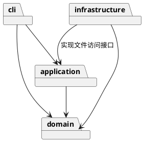

# 架构方案与开发记录

## 架构方案

实现范围是 Phase 1 的六种内置图形及命令总表。采用适度分层，所有业务实现使用封装字段的类，并保持一类一文件；接口和返回值对象仅用于跨层通信，不承担图形业务行为。

| 模块 | 职责 | 允许依赖 |
| --- | --- | --- |
| `domain` | 图形、组合树、画布、图形工厂及数值校验 | 无上层依赖 |
| `application` | Command、历史、编辑会话与文件访问接口 | domain |
| `infrastructure` | SVG XML 解析和本地文件访问 | application 的接口、domain、XML 库 |
| `cli` | 参数解析、命令分发、REPL 和显示 | application、domain |
| 启动入口 | 创建对象并注入依赖 | 各模块 |



实际工程目录如下，`main.ts` 是创建对象并注入依赖的入口：

```text
src/
  main.ts
  cli/             # Tokenizer、CommandArguments、CommandDispatcher、TreeView、Cli
  application/     # EditorSession、History、EditCommand、10 个具体编辑命令、DocumentStore
  domain/          # Shape、6 类图形、ShapeFactory、SvgDocument、Validator
  infrastructure/  # SvgCodec、SvgFileStore
test/              # 业务、文件、CLI、架构测试和内存文件替身
examples/          # 可回放的命令及生成的 SVG
doc/README.md      # 本文
```

领域层不导入 Node.js 文件接口、终端接口或第三方库；应用层只依赖领域模型和自身定义的 `DocumentStore`。文件实现通过构造函数注入 `EditorSession`，应用层不直接创建 `SvgFileStore`。CLI 可以读取模型来显示，但编辑统一调用会话和具体命令。

### 设计模式

- Command：每条编辑操作是独立命令；统一执行、撤销和重做，避免业务逻辑散落在命令行分支中。
- Composite：容器与叶子共享图形抽象，移动、缩放、显示和克隆通过多态完成。
- Memento：编辑前后使用内存快照恢复完整状态，确保父级、节点顺序和属性一起恢复。
- Factory：六类图形只在图形工厂注册；命令名只在命令分发器注册。这两处名字分派保留为后续插件化阶段的待重构点。

Command 的具体角色与调用过程：

| 角色 | 实现 | 职责 |
| --- | --- | --- |
| Client | CommandDispatcher | 解析输入并创建对应命令对象 |
| Command | EditCommand | 定义执行、撤销、重做以及快照规则 |
| ConcreteCommand | CreateCommand、MoveCommand 等 10 个类 | 在各自的 apply 方法中表达一项编辑操作 |
| Invoker | History | 持有成功命令，管理 undo/redo 栈与文档屏障 |
| Receiver | SvgDocument 和各 Shape 子类 | 维护树结构并执行真实图形行为 |

例如 `move node2 0 100` 的路径是：`CommandDispatcher → MoveCommand → EditorSession.execute → History.execute → EditCommand.execute → Group.move → 各子图形.move`。`EditCommand.execute` 是模板方法，统一生成快照、执行子类操作和失败回滚；撤销重做通过同一个命令对象恢复快照。因此命令类包含真实的编辑职责，并非仅用一个名字包装巨大分支。

图形的几何字段是私有字段。例如 `Rect` 自己维护 x、y、宽和高，实现自身的移动、缩放与属性校验；`Group` 将同样操作递归交给子节点。调用方使用 `Shape`，不需要判断“这是圆还是矩形”。样式、父级关系和扩展属性也不以可随意修改的公共数据袋暴露。

文档当前通过遍历树按 id 查找，避免同时维护树与索引导致恢复快照时漏同步。小型作业文档优先考虑清晰与可靠，后续性能需求出现时再加入索引。

### 变化点假设

- 新交互入口：复用应用层和领域模型，不依赖终端输入输出。
- 新图形类型：当前使用内置工厂；记录注册点，Phase 1 不提前实现 box 或插件加载器。
- 新存储方式：通过文件访问接口替换本地实现。
- 大型文档撤销：当前优先采用容易验证的快照；未来可替换为增量备忘录。

快照需要的内存随“历史命令数 × 文档大小”增长，这是为降低撤销重做复杂度做出的明确取舍。本阶段不引入 Visitor、事件总线、依赖注入框架或插件加载器，以免增加维护负担。

### 行为约定与需求补充

| 场景 | 本实现采用的规则 |
| --- | --- |
| 未创建文档 | 文档相关命令统一报规定的 no document 错误；help 可随时查看 |
| init 参数 | 无参数为 800×600；只有宽度时高度为 600；两个参数分别指定宽高 |
| 数值 | 接受有限十进制、浮点与指数表示；尺寸和半径非负，画布尺寸及缩放因子为正 |
| id | 大小写敏感；禁止空串或包含空白；SVG 根自身已有 id 也被保留并参与查重 |
| 注释及引号 | 仅整行去除前导空白后以 # 开头才是注释；颜色不会被截断；双引号内支持转义引号和反斜杠 |
| create in | 仅把末尾未加引号的 in 和后一个参数解释为归属子句；引用文本中的 in 是普通内容 |
| 同父分组 | 子图形按原文档顺序收入；新组占据最早被选中节点的位置 |
| 跨父分组 | 按原文档遍历顺序收入；新组位于根级末尾；选中祖先和后代同时分组会拒绝 |
| addto | 成为目标容器最后一个子节点；移入自身或后代会拒绝 |
| front / back | 分别移动到同级数组末尾 / 开头，对应 SVG 最后 / 最先绘制 |
| ungroup | 顶层 g 按要求拒绝；嵌套 g 的子节点提升到原位置，基本继承样式落实到缺少自身定义的子节点 |
| 容器 set | 设置 g 自身的 fill/stroke/stroke-width，遵循 SVG 继承；不覆盖子图形已有的显式样式 |
| scale | 同乘几何位置及尺寸，递归作用于子孙；不改变 stroke-width、字体大小等样式属性 |
| 编辑失败 | 整棵文档恢复，undo/redo 栈及文档路径均不改变 |
| 文档命令 | 成功 init/read/save/canvas 修改尺寸后清空旧历史并禁止 undo/redo；下一条成功编辑解除屏障 |
| 显示与查询 | tree/show/help、canvas 查询、空行及注释均不进入历史，也不解除或建立屏障 |
| 默认保存位置 | 成功 read 或显式 save 记住路径，后续无参数 save 复用；init 清除路径，首次保存须给路径 |
| 文件写入 | 先完整序列化，再写同目录临时文件并原子替换；失败不截断原文件 |

外部 SVG 支持范围：

- 解析六类元素，保持节点顺序、文本内容与 SVG 命名空间；省略 fill/stroke 时仍省略，不写死渲染默认值。
- 缺 id 前先扫描全部显式 id，再分配标签名+序号并输出警告；重复显式 id 拒绝整个导入。
- 保留根属性、非默认 viewBox、transform、字体、内联 style 和 data-*；不做坐标归一化。canvas 修改尺寸会把 viewBox 重设为 `0 0 w h`。
- 只读保留不等于完整 CSS 编辑支持：含内联 style 的图形拒绝 set；含 transform、复杂样式等属性的容器拒绝 ungroup。存在基本继承样式而子节点有内联 style 时，也拒绝解组，以免丢失继承语义。
- 不支持的元素（如 path、use、tspan）、DTD、外部实体、非法 XML、非法数值及百分比尺寸会明确报错。`data-kind="box"` 的 g 作为普通 g 保留，本阶段没有 box 语义。
- 这里没有完整 CSS、滤镜和变换计算引擎；带此类扩展属性的文件主要保证读写保留，结构编辑以本阶段基本图形语义为准。

## 过程记录

1. 阅读要求后明确：box 与插件不属于本阶段；Command、面向对象和 Composite 语义必须实际落地。
2. 用户强调代码简洁、可维护，因此采用四层结构，避免框架和通用插件系统。
3. 先建立工程与架构文档，再分别开发、验证和提交各模块，不以一次性大提交替代开发过程。
4. 命令状态恢复使用前后快照；专门模拟“容器前一个子节点成功、后一个子节点溢出”，确认整条命令回滚且不破坏 redo。
5. 交叉审查发现根 SVG 的 id 未参与后续创建的查重、数值入口接受十六进制、解组丢失继承样式；逐项复现并补回归测试。
6. 针对外部 SVG 的复杂样式，不加入 CSS 引擎：保留导入属性，无法安全维持语义的属性修改或解组明确拒绝，避免假装编辑成功却改变外观。
7. 接通 CLI 后增加独立进程回放测试，检查 EOF、中文、引号、错误恢复和非交互输出，防止“类的测试通过但入口不能运行”。
8. 自动化架构检查核对一类一文件、禁止散落 switch、模块导入方向。检查发现新版 TypeScript 包未提供此前预期的编译器 AST API，改为与本工程代码格式匹配的轻量源码规则，避免为测试额外引入旧编译器。
9. 回放要求中的完整会话和两节点流程图版本 A，检查元素数分别为 5、8，以及读入 other.svg 的 7 个元素和补 id 警告。两条示例预期错误分别为祖先/后代同时分组、保存后 undo。

这些记录描述本次真实的需求确认、交叉审查与修复；没有把 AI 自行发现的问题写成用户发现，也没有虚构运行结果。Git 以工程准备、领域模型、Command 历史、SVG IO、审查修复、CLI 综合验证及最终文档分别提交，保留了实现演进。

## 一致性自查

### 模块划分

实际目录与四层方案一致。增加的 `main.ts` 仅承担依赖组装；测试替身放在 test/helpers，不引入生产代码层。SVG 序列化保持在 infrastructure，没有为所有图形新增对 XML 库的依赖。

修订记录：初始根模型只含画布尺寸；读写审查后补充封装的 rootAttributes，保留非默认 viewBox 和 SVG 根视觉属性。初始基础解组不处理继承样式，审查后增加基本样式落实及复杂属性拒绝规则。模块边界未发生变化。

### 依赖方向

自动检查全部生产源码的导入规则，当前没有反向依赖。抽查结果：

- `MoveCommand → EditCommand → EditorSession / SvgDocument`，不依赖 readline 或文件库。
- `EditorSession → DocumentStore`，文件访问只通过接口调用。
- `SvgFileStore → DocumentStore / SvgCodec`，实现本地 IO 端口。
- `Group → Shape / Validator`，不认识应用命令或 CLI。
- `CommandDispatcher → 具体 Command`，只有它按命令名建立分发表。
- `ShapeFactory` 的单一图形注册表同时用于 create 和 SVG 读入。

名字分派的两个待重构点仍是 CommandDispatcher 与 ShapeFactory，后续插件阶段将以注册接口替换内置清单。当前未发现其他待处理的架构依赖违规。

## 质量保证手段

### 自动验证

```sh
npm ci
npm run check
npm test
npm run cli < examples/flowchart.commands
npm run cli < examples/session.commands
```

本次在 macOS、Node.js v24.16.0 下完成验证；严格类型检查通过，Node.js 测试报告 **61 项通过、0 项失败**（包括参数化的命令子测试）。

另外实际启动交互终端，确认启动说明、svg> 提示符、创建/显示/撤销和 Ctrl+D 退出正常；使用 macOS Quick Look 渲染生成的 flowchart.svg，核对两个中文节点、颜色及连接线显示正常。

| 测试部分 | 数量 | 主要依据 |
| --- | --- | --- |
| 领域模型 | 18 | 六类图形、多态几何、属性白名单、树顺序、防循环、根 id、继承样式、深克隆 |
| 应用与 Command | 22 | 每种编辑完整撤销重做、快照独立、部分失败回滚、redo 分支、文档屏障、文件失败 |
| SVG 与文件 | 11 | 缺 id 避让、默认样式、中文和 XML 转义、扩展属性往返、非法输入、原子写入 |
| CLI | 8 | 参数解析、精确错误、全部命令注册、典型会话、脚本输入和独立进程启动 |
| 架构规则 | 2 | 一类一文件、业务入口采用类、禁止 switch 分派、依赖方向 |

架构检查是对当前源码形式的自动约束，并辅以类职责与字段封装的人工/AI 交叉审查；测试不能证明支持任意 SVG。能力边界已在上文明确列出。

`.github/workflows/ci.yml` 配置 GitHub Actions，在 push 和 pull_request 时使用 Node.js 24 执行 npm ci、类型检查和测试。远程运行结果以仓库 Actions 页面为准，不把本地通过等同于已确认远程通过。

### 维护与复验

增加命令：先新增一个继承 EditCommand 的类，实现 apply 和撤销反馈，再在 CommandDispatcher 注册参数入口，最后补完整状态的撤销/重做与失败测试。

增加图形：新增 Shape 子类，实现自身几何行为、属性白名单、摘要与克隆，再在 ShapeFactory 唯一注册表中声明参数与构造方式。现有编辑命令和序列化遍历不应新增按类型分支。

修改后运行类型检查和测试，提交前查看 git diff。最终版本使用 final 标签定位，并将 main 与标签一起推送到用户指定的私有 GitHub 仓库；不改写已有提交历史。
