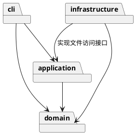

# 架构方案与开发记录

## 架构方案

采用适度分层，所有业务实现使用封装字段的类，并保持一类一文件。

| 模块 | 职责 | 允许依赖 |
| --- | --- | --- |
| `domain` | 图形、组合树、画布、图形工厂及数值校验 | 无上层依赖 |
| `application` | Command、历史、编辑会话与文件访问接口 | domain |
| `infrastructure` | SVG XML 解析和本地文件访问 | application 的接口、domain、XML 库 |
| `cli` | 参数解析、命令分发、REPL 和显示 | application、domain |
| 启动入口 | 创建对象并注入依赖 | 各模块 |

### 设计模式

- Command：每条编辑操作是独立命令；统一执行、撤销和重做，避免业务逻辑散落在命令行分支中。
- Composite：容器与叶子共享图形抽象，移动、缩放、显示和克隆通过多态完成。
- Memento：编辑前后使用内存快照恢复完整状态，确保父级、节点顺序和属性一起恢复。
- Factory：六类图形只在图形工厂注册；命令名只在命令分发器注册。这两处名字分派保留为后续插件化阶段的待重构点。

### 变化点假设

- 新交互入口：复用应用层和领域模型，不依赖终端输入输出。
- 新图形类型：当前使用内置工厂；记录注册点，Phase 1 不提前实现 box 或插件加载器。
- 新存储方式：通过文件访问接口替换本地实现。
- 大型文档撤销：当前优先采用容易验证的快照；未来可替换为增量备忘录。

## 过程记录

1. 阅读要求后明确：box 与插件不属于本阶段；Command、面向对象和 Composite 语义必须实际落地。
2. 用户强调代码简洁、可维护，因此采用四层结构，避免框架和通用插件系统。
3. 先建立工程与架构文档，再分别开发、验证和提交各模块，不以一次性大提交替代开发过程。

## 一致性自查

开发完成后依据实际目录及导入关系更新本节。

## 质量保证手段

计划采用 TypeScript 严格类型检查、Node.js 内置测试、示例命令回放和 SVG 往返验证。
